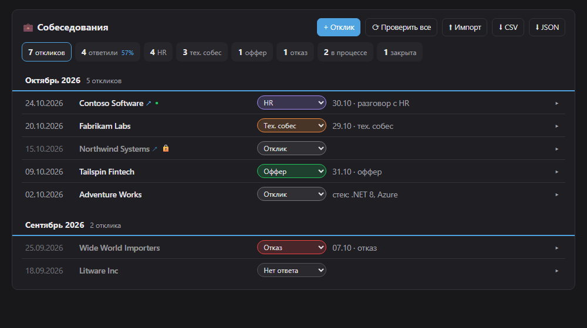

# JobTracker

[](https://github.com/limonStack/JobTracker/actions/workflows/ci.yml)

Трекер откликов на вакансии: воронка (отклик → HR → тех. собес → оффер), история событий по каждой компании
и **автоматическая проверка — открыта ли ещё вакансия на сайте**. Сейчас поддерживаются [DOU](https://jobs.dou.ua)
и [Work.ua](https://www.work.ua), архитектура рассчитана на добавление других сайтов.



## Возможности

- Воронка откликов с фильтрами по этапам и статистикой «сколько ответили / дошли до HR / тех. собеса»
- История событий по каждому отклику; смена этапа сама пишет событие
- Проверка вакансий на сайте:
  - в фоне раз в сутки и при запуске приложения;
  - по кнопке «Проверить все» или «Проверить сейчас» для одной вакансии;
  - закрытые вакансии помечаются 🔒 и попадают в фильтр «закрыты»
- Импорт из старого трекера (localStorage), экспорт в CSV и JSON

## Стек

- .NET 10, ASP.NET Core Minimal API
- EF Core 10 + SQLite
- `BackgroundService`, `PeriodicTimer`, `System.Threading.Channels`
- `IHttpClientFactory` + `Microsoft.Extensions.Http.Resilience` (Polly)
- AngleSharp — разбор HTML
- xUnit, `WebApplicationFactory`; GitHub Actions
- Фронтенд — ванильный JS без сборки

## Запуск

Нужен [.NET 10 SDK](https://dotnet.microsoft.com/download/dotnet/10.0).

```bash
dotnet run --project src/JobTracker.Api
```

Откройте http://localhost:5196. База `jobtracker.db` создаётся рядом с проектом при первом запуске, миграции применяются автоматически.

Тесты:

```bash
dotnet test
```

### Настройки

`src/JobTracker.Api/appsettings.json`:

```jsonc
"VacancyChecks": {
  "ScheduleEnabled": false,           // проверять по таймеру (сейчас выключено — только «Проверить все»)
  "Interval": "1.00:00:00",          // как часто проверять все вакансии
  "DelayBetweenRequests": "00:00:02", // пауза между запросами к сайту
  "CheckOnStartup": false             // проверить сразу при запуске
}
```

### Секреты и личные данные

Репозиторий публичный, поэтому:

- **Секреты — только вне репозитория.** Для разработки — `dotnet user-secrets` (хранятся в профиле пользователя):
  ```bash
  dotnet user-secrets set "ConnectionStrings:JobTracker" "<строка подключения>" --project src/JobTracker.Api
  ```
  на сервере и в облаке — переменные окружения (`ConnectionStrings__JobTracker`) или хранилище секретов.
- **Не попадают в git** (`.gitignore`): база `*.db`, `content/private/` (личные разделы ответов), `backups/`
  (выгрузки данных из браузера), `.env*`, `appsettings.*.local.json`, ключи и сертификаты.
- **Хук `pre-commit`** останавливает коммит, если в нём такие файлы или строки, похожие на секрет
  (ключи API, токены, `Password=` в строке подключения); если установлен [gitleaks](https://github.com/gitleaks/gitleaks) — запускает и его.
  Подключается один раз после клонирования:
  ```bash
  git config core.hooksPath .githooks
  ```
- **CI** проверяет gitleaks всю историю при каждом пуше и PR.
- В настройках репозитория на GitHub стоит включить **Secret scanning** и **Push protection**
  (Settings → Code security): GitHub сам отклонит пуш с известным типом токена.

### Тексты ответов

`content/answers.html` — вопросы и ответы (копия из проекта 300questions без личных разделов), из неё
приложение заполняет базу. Личные разделы лежат рядом в `content/private/` и в репозиторий не попадают:
если папки нет, приложение работает без них.

## Архитектура

```
src/
  JobTracker.Domain          — сущности и бизнес-правила, без внешних зависимостей
  JobTracker.Application     — сценарии использования и интерфейсы (порты)
  JobTracker.Infrastructure  — EF Core/SQLite, проверка вакансий по HTTP, очередь
  JobTracker.Api             — Minimal API, фоновый воркер, фронтенд (wwwroot)
tests/
  JobTracker.UnitTests        — домен, DouChecker и WorkUaChecker на сохранённых страницах
  JobTracker.IntegrationTests — API целиком через WebApplicationFactory
```

Зависимости направлены внутрь: `Api → Infrastructure → Application → Domain`.

### Как работает проверка вакансии

```
таймер (раз в сутки) ─┐
кнопка «Проверить все» ┴─► Channel ─► VacancyCheckWorker ─► VacancyCheckService
                                        (BackgroundService)      │
                                                                 ▼
                               VacancyCheckerResolver ─► DouChecker    ─► jobs.dou.ua
                                                       └► WorkUaChecker ─► www.work.ua
                                                                 │
                              JobApplication.RecordCheck ◄───────┘
                                     │ вакансия закрылась
                                     ▼
                              VacancyClosedEvent ─► подписчики (лог; дальше — Telegram)
```

На DOU у закрытой вакансии к заголовку дописано «(вакансія неактивна)», а блок описания получает класс
`__inactive`. `DouChecker` смотрит на оба признака. Если на странице нет ни того, ни другого (капча, новая
разметка), результат — «не удалось проверить», а не «открыта».

Work.ua закрытые вакансии не помечает, а убирает: недавно снятая отдаёт 301 на поиск с `?job_removed=1`,
давняя — 410 «вакансію не знайдено». `WorkUaChecker` решает по ответу ещё до разбора HTML
(хук `AnalyzeResponse` в `HtmlVacancyChecker`), а открытой считает страницу с `h1#h1-name`.

### Паттерны и решения

| Что | Где | Зачем |
|---|---|---|
| Rich Domain Model, Aggregate | `JobApplication` | правила воронки внутри сущности: этап меняется только через `MoveTo` |
| Value Object | `VacancyUrl` | ссылка всегда валидная и нормализованная |
| Domain Events / Observer | `VacancyClosedEvent`, `IDomainEventHandler<T>` | реакции на закрытие добавляются без изменения проверки |
| Strategy | `IVacancyChecker` → `DouChecker`, `WorkUaChecker` | своя проверка для каждого сайта |
| Template Method | `HtmlVacancyChecker` | общий скелет «загрузить → разобрать → решить» |
| Open/Closed | `VacancyCheckerResolver` | новый сайт = новый класс + строка регистрации |
| Result pattern | `VacancyCheckResult` | сбой сети — ожидаемый исход, а не исключение |
| Repository + Unit of Work | `IJobApplicationRepository`, `JobTrackerDbContext` | события рассылаются только после успешного `SaveChanges` |
| Producer–Consumer | `ChannelVacancyCheckQueue` + `VacancyCheckWorker` | HTTP-запрос не ждёт обхода всех сайтов |
| Options pattern | `VacancyCheckOptions` | настройки с валидацией при старте |
| Decorator (DelegatingHandler) | `AddStandardResilienceHandler` | повторы и таймауты поверх HttpClient |
| DI lifetimes | `IServiceScopeFactory` в воркере | singleton-воркер не держит scoped `DbContext` |

## Перенос данных из старого трекера

Переносится всё, что старый сайт (300questions/ANSWERS.html) хранил в браузере: прогресс «изучено» с датами,
тренировки и ИИ, повторение, отклики, идеи, выделения, «календарь открыт» и режим 🎯.

1. Откройте старый сайт, нажмите F12 → Console и выполните — команда только **читает** данные и копирует их в буфер:
   ```js
   copy(JSON.stringify(Object.fromEntries(Object.keys(localStorage)
     .filter(k => k.startsWith('net-interview-')).map(k => [k, localStorage.getItem(k)]))))
   ```
2. Сохраните скопированное в файл в папке `backups/` (она не попадает в git) — это резервная копия.
3. Отправьте в JobTracker: `POST /api/import/site` с этим JSON (кнопка в интерфейсе появится вместе с новой страницей).

Импорт идемпотентный: повторный запуск не создаёт дублей. В ответе — сколько перенесено по каждому модулю
и что не удалось (например, вопрос, которого больше нет в базе знаний). Отметки «изучено» без даты
(старые версии сайта) переносятся как изученные, но в календаре не считаются.

## Планы

- Проверка вакансий на Djinni
- Уведомление в Telegram о закрытии вакансии (ещё один подписчик `VacancyClosedEvent`)
- Запуск как Windows Service
