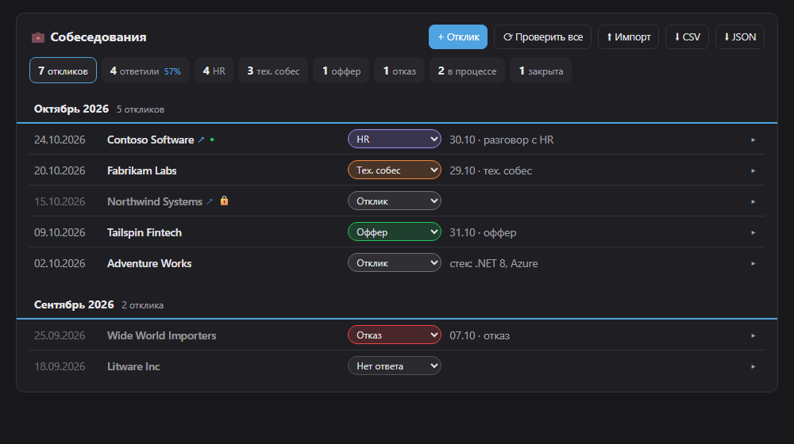

# JobTracker

[](https://github.com/limonStack/JobTracker/actions/workflows/ci.yml)

Подготовка к собеседованию .NET-разработчика и трекер откликов в одном приложении:

- **база знаний** — вопросы с ответами по разделам, поиск (номера, синонимы, опечатки, неверная раскладка),
  прогресс, календарь занятий, режим собеседования, выделения и заметки;
- **отклики** — воронка (отклик → HR → тех. собес → оффер), история событий и проверка в фоне,
  открыта ли ещё вакансия на [DOU](https://jobs.dou.ua) и [Work.ua](https://www.work.ua).

Работает офлайн (PWA): данные копируются в браузер, правки уходят на сервер, когда он доступен.



## Запуск

Нужен [.NET 10 SDK](https://dotnet.microsoft.com/download/dotnet/10.0).

```bash
dotnet run --project src/JobTracker.Api   # http://localhost:5196, база SQLite создаётся при первом запуске
dotnet test                               # unit + integration
npm test                                  # фронтенд: node --test, без зависимостей
```

## Стек

.NET 10, ASP.NET Core Minimal API, EF Core + SQLite, `BackgroundService` + `Channel`, `IHttpClientFactory` + Polly,
AngleSharp, xUnit + `WebApplicationFactory`, GitHub Actions. Фронтенд — ванильный JS без сборки, IndexedDB, service worker.

## Архитектура

Clean Architecture, зависимости направлены внутрь: `Api → Infrastructure → Application → Domain`.

```
src/
  JobTracker.Domain          — сущности и бизнес-правила, без внешних зависимостей
  JobTracker.Application     — сценарии и порты
  JobTracker.Infrastructure  — EF Core, проверка вакансий по HTTP, очередь
  JobTracker.Api             — Minimal API, фоновый воркер, фронтенд (wwwroot)
content/answers.html         — тексты ответов, из них заполняется база
tests/                       — unit, integration, фронтенд
```

| Решение | Где |
|---|---|
| Rich Domain Model, Value Object, Domain Events | `JobApplication`, `VacancyUrl`, `VacancyClosedEvent` |
| Strategy + Template Method для сайтов вакансий | `IVacancyChecker`, `HtmlVacancyChecker` |
| Producer–Consumer | `ChannelVacancyCheckQueue` → `VacancyCheckWorker` |
| Unit of Work, события после коммита | `JobTrackerDbContext` |
| Данные по пользователям | `IUserOwned` + глобальный фильтр EF Core |
| Офлайн-синхронизация с идемпотентными запросами | `wwwroot/js/sync.js`, UUID v7 из браузера |

Подробности для разработки — в [CLAUDE.md](CLAUDE.md).

## Секреты

Репозиторий публичный: секреты — только в `dotnet user-secrets` или переменных окружения. Базы, личные разделы
и резервные копии исключены в `.gitignore`; хук `.githooks/pre-commit` (`git config core.hooksPath .githooks`)
и gitleaks в CI не пропускают секреты в историю.
