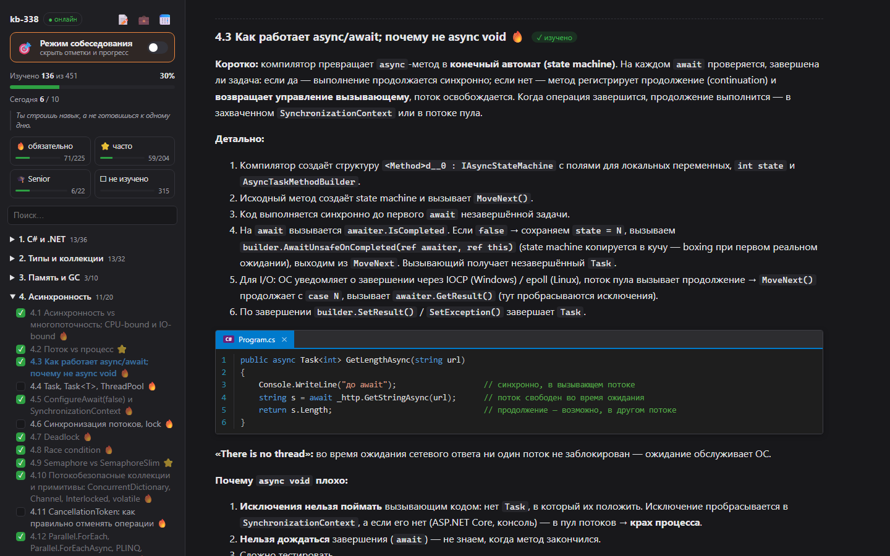
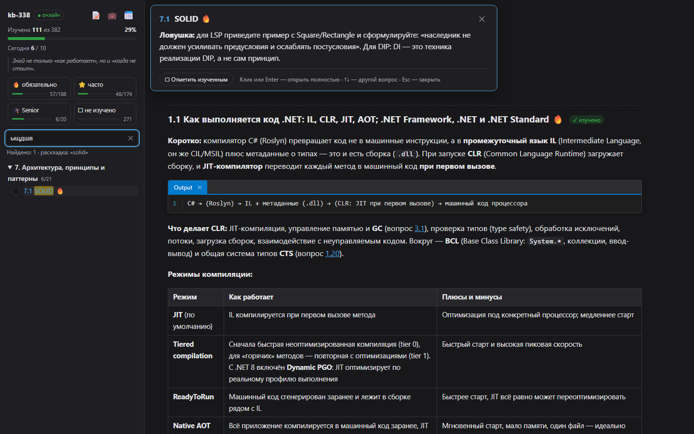
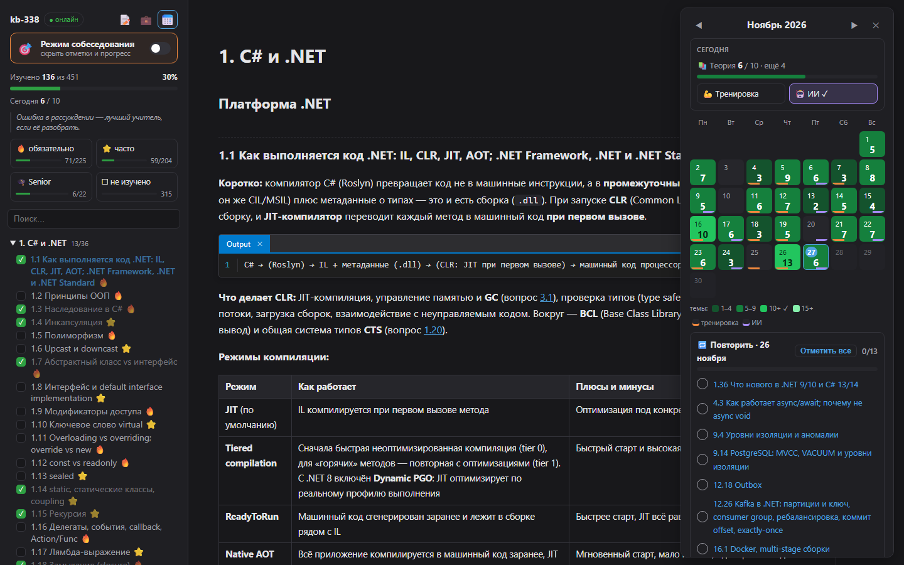
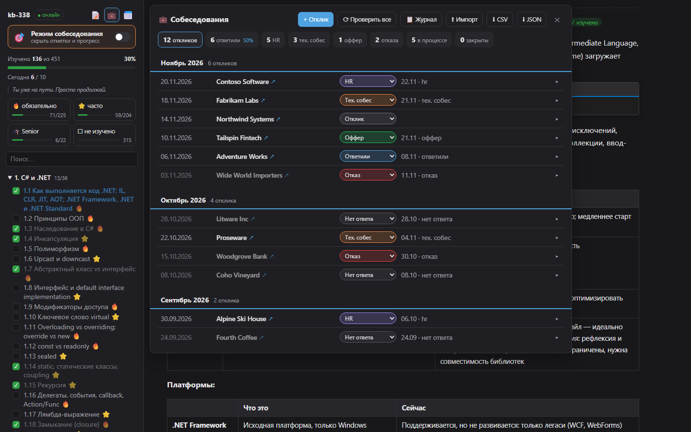
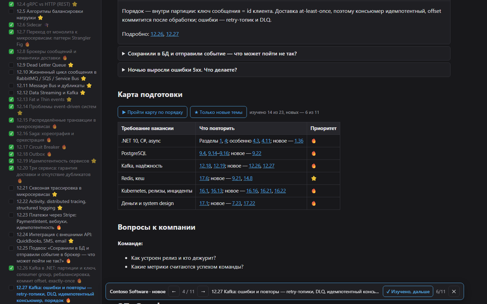

# JobTracker

[](https://github.com/limonStack/JobTracker/actions/workflows/ci.yml)

Подготовка к собеседованию .NET-разработчика и трекер откликов в одном приложении:

- **база знаний** — вопросы с ответами по разделам, поиск (номера, синонимы, опечатки, неверная раскладка),
  прогресс, календарь занятий, выделения и заметки; разделы под вакансию с картой подготовки
  и проходом по её темам по одной;
- **отклики** — воронка (отклик → HR → тех. собес → оффер), история событий и проверка в фоне,
  открыта ли ещё вакансия на [DOU](https://jobs.dou.ua) и [Work.ua](https://www.work.ua).

Работает офлайн (PWA): данные копируются в браузер, правки уходят на сервер, когда он доступен.



| Поиск — даже в неверной раскладке | Календарь занятий | Трекер откликов |
|---|---|---|
| [](docs/screenshots/search.png) | [](docs/screenshots/calendar.png) | [](docs/screenshots/tracker.png) |

Раздел под вакансию: вероятные вопросы, «Карта подготовки» со ссылками на темы базы и проход по ним по одной
(панель внизу) — см. [`/interview-prep`](#interview-prep--подготовка-к-вакансии).



<sub>На скриншотах — демо-данные: компании выдуманные.</sub>

## Запуск

Нужен [.NET 10 SDK](https://dotnet.microsoft.com/download/dotnet/10.0).

```bash
dotnet run --project src/JobTracker.Api   # http://localhost:5196, база SQLite создаётся при первом запуске
dotnet test                               # unit + integration
npm test                                  # фронтенд: node --test, без зависимостей
```

## Стек

.NET 10, ASP.NET Core Minimal API, EF Core + SQLite, `BackgroundService` + `Channel`, `IHttpClientFactory` + Polly,
AngleSharp, xUnit + `WebApplicationFactory`, GitHub Actions. Фронтенд — ванильный JS без сборки, IndexedDB, service worker.

## Архитектура

Clean Architecture, зависимости направлены внутрь: `Api → Infrastructure → Application → Domain`.

```
src/
  JobTracker.Domain          — сущности и бизнес-правила, без внешних зависимостей
  JobTracker.Application     — сценарии и порты
  JobTracker.Infrastructure  — EF Core, проверка вакансий по HTTP, очередь
  JobTracker.Api             — Minimal API, фоновый воркер, фронтенд (wwwroot)
content/answers.html         — тексты ответов, из них заполняется база
tests/                       — unit, integration, фронтенд
```

| Решение | Где |
|---|---|
| Rich Domain Model, Value Object, Domain Events | `JobApplication`, `VacancyUrl`, `VacancyClosedEvent` |
| Strategy + Template Method для сайтов вакансий | `IVacancyChecker`, `HtmlVacancyChecker` |
| Producer–Consumer | `ChannelVacancyCheckQueue` → `VacancyCheckWorker` |
| Unit of Work, события после коммита | `JobTrackerDbContext` |
| Данные по пользователям | `IUserOwned` + глобальный фильтр EF Core |
| Офлайн-синхронизация с идемпотентными запросами | `wwwroot/js/sync.js`, UUID v7 из браузера |

Подробности для разработки — в [CLAUDE.md](CLAUDE.md).

## Claude Code: скилл и хуки

В репозитории настроены скилл и хуки [Claude Code](https://claude.com/claude-code) (`.claude/`) — они подхватываются
сами, когда Claude Code открыт в папке проекта.

### `/interview-prep` — подготовка к вакансии

Пришлите ссылку на вакансию (или её текст) и вызовите скилл:

```
/interview-prep https://jobs.dou.ua/companies/<компания>/vacancies/<id>/
```

Если в сообщении просто есть ссылка на вакансию, хук сам предложит `/interview-prep`.

Что делает скилл:

1. **Трекер** — сразу заводит отклик (этап «Откликнулся») или находит существующий; дублей не создаёт.
2. **Вероятные вопросы** — 20–30 вопросов, которые зададут именно по этой вакансии, с короткими ответами
   на 30–60 секунд: рекрутер → техническое → домен и system design → поведенческие.
3. **Анализ пробелов** — какие требования база уже покрывает, а каких тем не хватает.
4. **Согласование** — показывает список вопросов, пробелы и куда пойдёт каждая новая тема, и ждёт ответа.
   Можно убрать или добавить темы.
5. **Новые темы** — дописывает в конец подходящих разделов базы (Kafka — в «Микросервисы», system design —
   в «System Design»), обобщённо и без названия компании. Нумерация существующих вопросов и отметки не сдвигаются.
6. **Раздел компании** — в личном файле `content/private/` (вне git), в меню — блок «🏢 Компании»:
   вакансия и чего ждать, вероятные вопросы, «Карта подготовки» (таблица ссылок на темы базы), домен,
   вопросы к компании.
7. **Проверка** — ссылки, нумерация, сборка, загрузка в приложение; событие в трекере.

Как пользоваться результатом:

- **Вероятные вопросы** — ответьте вслух, потом раскройте короткий ответ; «Подробно:» ведёт к полному.
- **Карта подготовки** — кнопки над таблицей проводят по её темам по одной: «Пройти карту по порядку»
  или «Только новые темы». Внизу — панель `← 3 / 14 →` и «✓ Изучено, дальше»; клавиши `[` и `]`.
  Счётчик компании в меню — изучено из тем её карты.
- «Назад» в браузере возвращает к месту, откуда ушли по ссылке.

Скрипты скилла работают и сами по себе (из корня репозитория):

| Скрипт | Зачем |
|---|---|
| `node .claude/skills/interview-prep/scripts/list-questions.mjs [--sections]` | оглавление базы: разделы и вопросы обоих файлов |
| `node .claude/skills/interview-prep/scripts/check-content.mjs` | проверка контента: битые ссылки, нумерация, метки 🔥⭐🎓, ссылки из публичного файла в личный |
| `node .claude/skills/interview-prep/scripts/append-questions.mjs <раздел> <файл>` | дописать вопросы в конец раздела со сквозной нумерацией |
| `node .claude/skills/interview-prep/scripts/tracker.mjs --company … --url …` | отклик в трекере (нужно запущенное приложение) |

### Хуки

| Хук | Когда | Что делает |
|---|---|---|
| `vacancy-link.mjs` | вы отправили сообщение | есть ссылка на вакансию — подсказывает `/interview-prep` |
| `dev-app.mjs` | сборка, конец ответа Claude | останавливает приложение перед Debug-сборкой; если за ответ менялись `src/` или `content/` — перезапускает его с правками (обновите вкладку). Отладка — F5 с конфигурацией «Attach JobTracker» |
| `readme-check.mjs` | после `git commit` | новая возможность без правки README — просит проверить README |

## Секреты

Репозиторий публичный: секреты — только в `dotnet user-secrets` или переменных окружения. Базы, личные разделы
и резервные копии исключены в `.gitignore`; хук `.githooks/pre-commit` (`git config core.hooksPath .githooks`)
и gitleaks в CI не пропускают секреты в историю.
